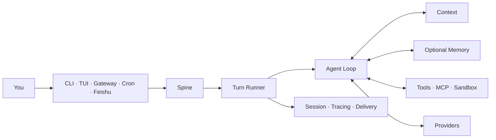

<div align="center">

# Orbit

### One Agent Runtime across every place you work.

Run the same tool-using agent in your terminal, native TUI, background Gateway,
scheduled jobs, and message channels. The entry point changes; the Turn,
Session, Context, tools, and evidence model stay the same.


[Quick start](#from-install-to-a-real-reply) ·
[First-use guide](docs/onboarding/README.zh-CN.md) ·
[Feishu](docs/onboarding/feishu.zh-CN.md) ·
[Agent install contract](docs/onboarding/agent-install.md) ·
[中文](README.zh-CN.md)

</div>

---

Orbit is a compact Agent Harness. Every host submits a Turn through the same
Runtime instead of building its own agent loop. Orbit owns scheduling,
cancellation, Context assembly, tool execution, Session persistence, Tracing,
and delivery. Optional Memory backends plug into that Runtime, but this release
does not bundle an external Memory implementation.



## From install to a real reply

Orbit requires Python 3.12. Clone the repository and install it locally as an editable tool:

```bash
git clone https://github.com/2017874191-crypto/Orbit.git
cd Orbit
uv tool install --editable .
```

On Windows, use the same commands in PowerShell. This local install exposes the `orbit` command.

Configure Orbit inside the repository where the agent will work:

```bash
cd /path/to/your-project
orbit onboard --skip-memory
```

The four-step wizard follows the first result you can verify:

```text
LLM credentials -> Memory explicitly off -> first real Turn
                -> run location -> optional message channel
```

The current Gitee release does not contain an external Memory implementation,
so `--skip-memory` is the supported path. Orbit records
`memory.backend = null`; it does not pretend that a missing backend is healthy.

After onboarding:

```bash
orbit
orbit run -m "Map the main request path in this repository"
orbit doctor --probe
```

`orbit doctor --probe` sends a real model request. A static configuration check
or a skipped probe does not prove that the Provider returned a reply.

See the [first-use guide](docs/onboarding/README.zh-CN.md) for private Release
authentication, non-interactive setup, exact acceptance checks, and recovery
paths.

## What Orbit owns

| What you need | What Orbit does |
| --- | --- |
| One agent across several surfaces | CLI, TUI, Gateway, Cron, and Channels submit the same Turn contract |
| Context that does not become a prompt dump | Context is retrieved, budgeted, and assembled before each model call |
| Tools with explicit boundaries | Filesystem, Shell, Web, MCP, messaging, and Subagents share confirmation and Sandbox controls |
| Recoverable conversations | Sessions persist independently from the current terminal process |
| Debuggable outcomes | Tracing, Provider usage, delivery state, and evaluation evidence remain separate records |
| Controlled improvement | Evolver produces candidates and evidence; activation and rollback remain explicit operator actions |

## Connect Feishu

Orbit uses Feishu's WebSocket long connection, so you do not need a public IP or
webhook domain.

```bash
orbit channels enable feishu \
  --app-id "cli_xxxxxxxxxxxxxxxx" \
  --app-secret "$FEISHU_APP_SECRET"

cd /path/to/your-project
orbit gateway --workspace "$PWD" --verbose
```

The Feishu app still needs bot capability, message permissions,
`im.message.receive_v1`, and a published application version. Follow the
[Feishu guide](docs/onboarding/feishu.zh-CN.md) before testing an inbound
message. Saving channel configuration does not prove that live delivery works.

## Commands worth remembering

| Goal | Command |
| --- | --- |
| Configure Orbit and run the first Turn | `orbit onboard --skip-memory` |
| Open the native TUI | `orbit` |
| Execute one Turn | `orbit run -m "..."` |
| Check Runtime and Provider health | `orbit doctor --probe` |
| Inspect installed Plugins | `orbit plugins` |
| Manage message channels | `orbit channels ...` |
| Serve enabled channels | `orbit gateway --workspace /path/to/project` |
| Manage scheduled work | `orbit cron ...` |
| Inspect Sessions and Tracing | `orbit sessions ...` / `orbit tracing` |
| Run operator-controlled evolution | `orbit evolve check\|run\|status\|finalize` |

## State and security

| Scope | Default location |
| --- | --- |
| Global configuration and Runtime data | `~/.orbit` |
| Foreground project | current directory |
| Foreground project state | `~/.orbit/projects/<project-id>` |
| Gateway Workspace | explicit `--workspace`, otherwise `~/.orbit/workspace` |

Normal startup keeps Orbit state outside the repository. Executable Plugins are
loaded only from Orbit's bundled set, operator-managed `~/.orbit/plugins/`, and
installed `orbit.plugins` entry points. A checkout's `.orbit/plugins/` directory
is not an automatic startup source.

Read the [Memory boundary](docs/onboarding/memory.zh-CN.md) and
[troubleshooting guide](docs/onboarding/troubleshooting.md) before changing a
backend or handing the installation to another operator.

## Release repository boundary

This repository contains publishable source, deterministic tests, reviewed
benchmark code and fixtures, installers, onboarding material, and legal
notices. It excludes development plans, raw run artifacts, credentials, private
environment instructions, and unpublished external Memory artifacts.

Public benchmark results apply only to the frozen workload and verifier named
in their documents. They are not production SLAs. Start with the
[evaluation index](docs/evaluation/README.md) and [`benchmarks/`](benchmarks/).

## Contributing

Start with an issue labeled `good-first-issue`. Every claimable issue names its
target branch, relevant files, scope, and acceptance command. Comment on the
issue before starting, then submit one pull request for that issue.

See the [contribution guide](CONTRIBUTING.md) for branch selection, local
verification, and safety requirements. Remove tokens, private keys, internal
addresses, and personal data from public issue reports.

## Build and verify

```bash
uv sync --frozen --extra dev --dev
npm ci
npm ci --prefix ui-tui
make check
make orbitbench-smoke
ORBIT_RELEASE_OUTPUT=/absolute/empty/output make release-dist
```

Orbit is pre-1.0. Interfaces can change. `make check` verifies the retained
release tree; it does not replace a real Provider or channel smoke test.

## License

Orbit is licensed under Apache License 2.0. See [LICENSE](LICENSE),
[NOTICES.md](NOTICES.md), and [LICENSES/](LICENSES/) for attribution.
